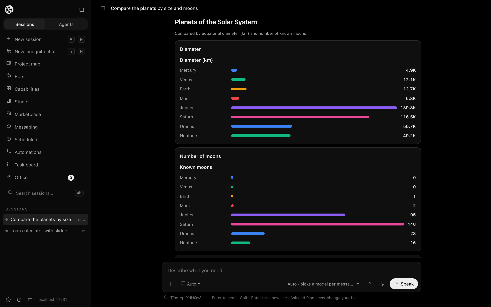
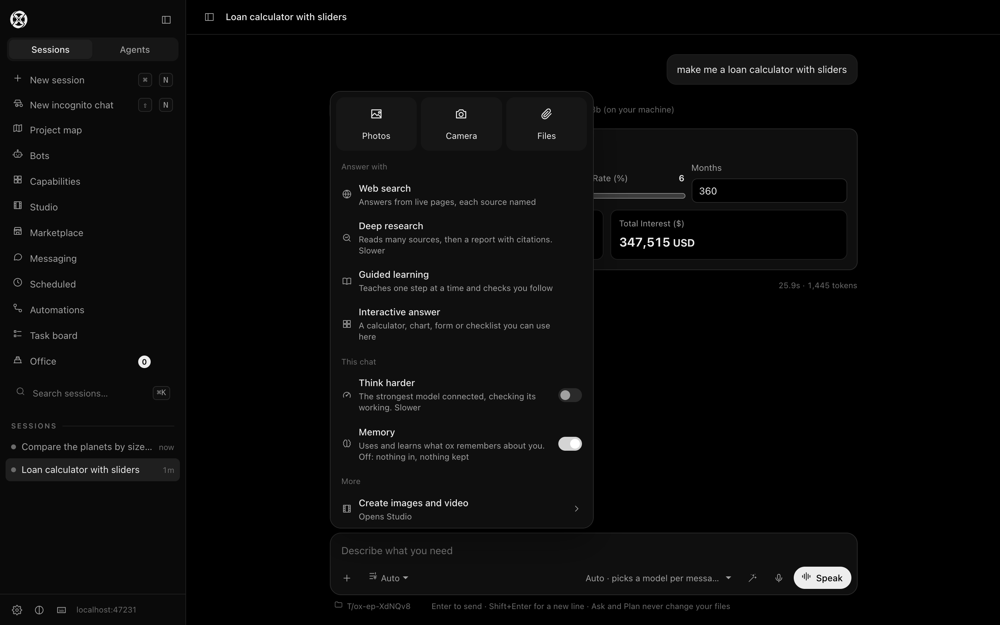
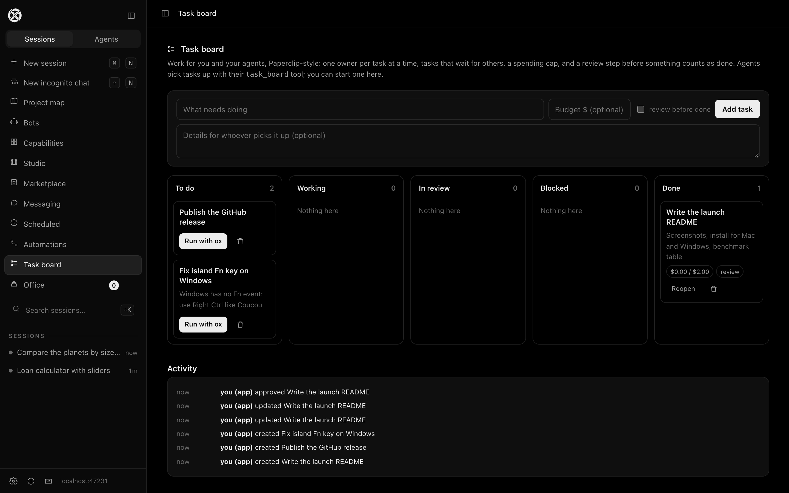
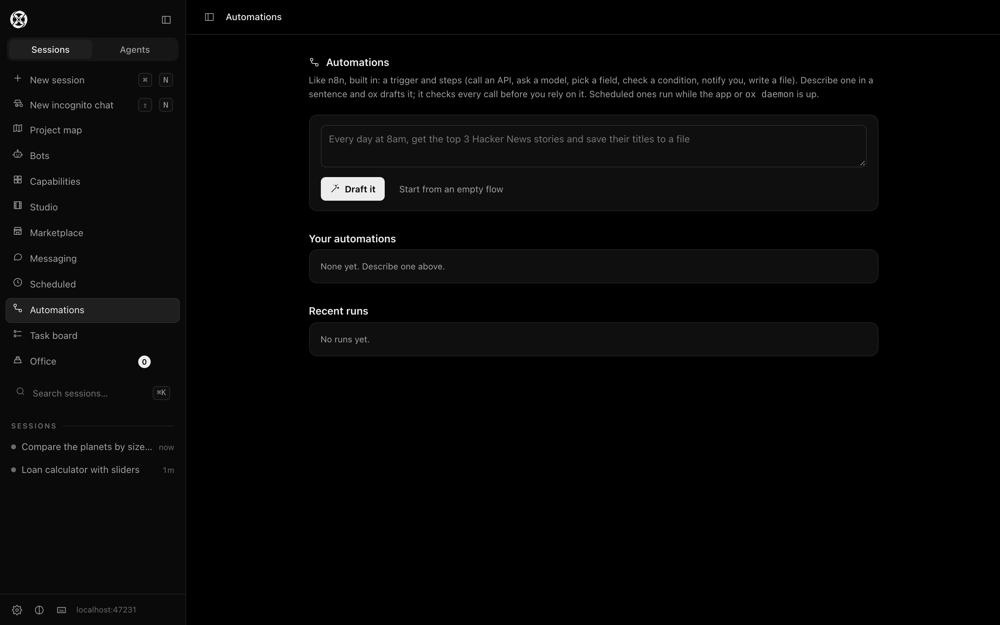
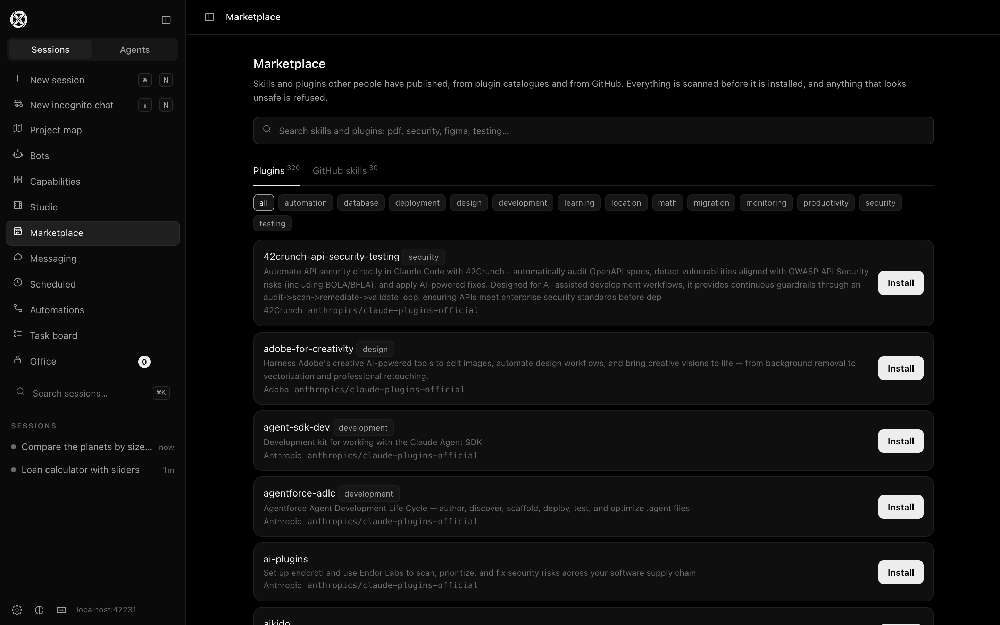
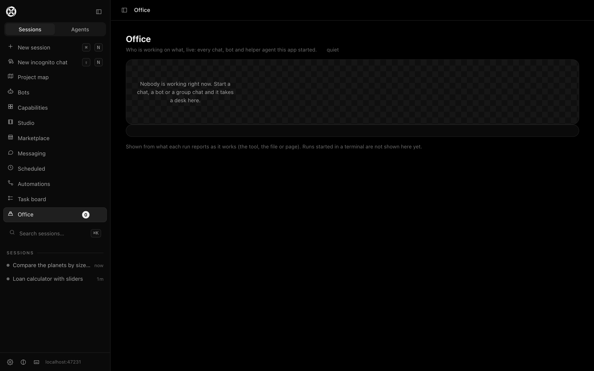
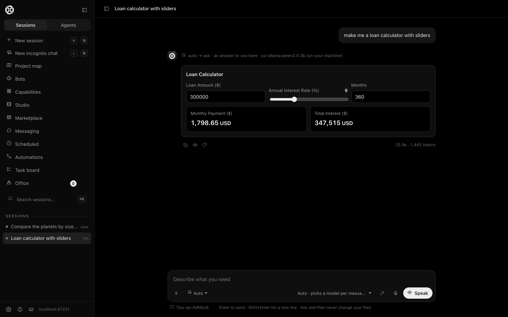
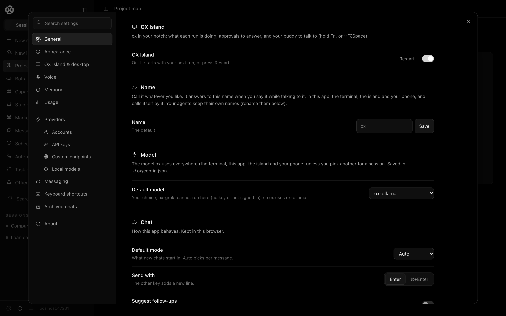

# ox

**A coding agent that checks its own work.** Terminal, desktop app and a voice
assistant in your Mac's notch. It runs on the AI you already pay for (Claude,
ChatGPT, Cursor) or any API key or local model, with no dependencies, no
account and no telemetry.



## Why ox

Models write plausible code. ox makes them prove it, whichever model it is.

| The problem | What ox does | Measured |
|---|---|---|
| **Security holes**, whatever the model | `ox secure` scans code for 62 vulnerability patterns (injection, XSS, SSRF, path traversal, secrets, weak crypto…), each with its CWE and a fix. When the agent edits a file, ox scans it and makes the model fix what it introduced. | Held-out lines: **24/27 caught on the first run, 0/18 false alarms**. DVNA, untuned: 3/7 on the first run, 6/7 after. OWASP NodeGoat: 7/8. Found 3 real command-injection risks in ox itself. [Details](bench/security/RESULTS.md) |
| **Requirements turned into code that misses the point** | `ox build "<requirement>"` turns it into numbered acceptance criteria for *your* project, writes a test for each before the code, codes until they pass, then proves each criterion separately. | A real business requirement on the ChatGPT plan: 7 criteria, tests failed first, **7/7 proven**, code checked by hand. [Details](bench/build/RESULTS.md) |
| **Language migrations that break** | `ox port <project> --to <lang>` inventories everything the project touches (env vars, files, endpoints, ports, commands, databases), ports module by module in dependency order with the tests, and names anything the port forgot. | A JS project to Python: **11/11 of the same tests pass**, the env var and data file kept, one behaviour difference reported rather than hidden. [Details](bench/port/RESULTS.md) |
| **Cost and speed** | One request per answer, a small prompt, tools offered only when needed. | Against Hermes, same model: starts **13× faster** (166 ms vs 2,250 ms), sends **5× fewer tokens** per request (2,073 vs 10,923), 1 request per answer vs 3. [Method](bench/compare-hermes.mjs) |

What is **not** proven yet, and is on the list: a head-to-head on real coding
tasks against Claude Code, Codex and others on the same model (the runner is
built, `bench/h2h/`; the full run is pending), and the public benchmarks
(SWE-bench, Terminal-Bench). No claim here goes beyond the linked files.

## Get it

**Mac app** (Apple Silicon): download `ox-mac-arm64.zip` from
[Releases](https://github.com/SAI141003/ox/releases), unzip, drag **OX** to
Applications. It brings its own runtime; nothing else to install. The app is
not notarized by Apple yet: the first time, right-click **OX** › Open (or
System Settings › Privacy & Security › Open Anyway).

**Terminal** (macOS, Linux, Windows; Node 18 or later):

```bash
git clone https://github.com/SAI141003/ox.git
```

```bash
cd ox && npm link
```

```bash
ox
```

Then connect a model: `ox connect` finds the Claude, ChatGPT or Cursor plan you
are signed in to; or set any API key (Anthropic, OpenAI, Gemini, xAI, Groq,
DeepSeek, Mistral, OpenRouter… 22 providers); or run a local model with Ollama.

**Windows**: the same commands in PowerShell, or `ox-windows-x64.zip` from
[Releases](https://github.com/SAI141003/ox/releases) (`ox.cmd` for the terminal,
`OX.vbs` for the app window). The notch island is macOS only.

## What's inside



- **Agent** with modes (ask, plan, code, orchestrate), approvals for every
  write and command, subagents that delegate and report back, a task board,
  memory that persists across sessions, and goals that refuse "done" until proven.
- **Interactive answers**: calculators, charts, tables and forms drawn in the
  chat by any model, even a 3B local one.
- **OX Island**, the notch assistant: "play Billie Jean", "lower the music",
  "what's on my to-do list today", "open Chrome and YouTube", all **without AI
  and offline, in about 0.1 s**. Questions go to your local model in 2–3 s, and
  real tasks to an agent. Hold **Fn** to talk, rename it, dictation anywhere,
  call notes.
- **Automations**, n8n-style and built in: triggers (by hand, schedule,
  webhook) and steps (HTTP, ask a model, extract, if, notify, write).
- **Marketplace**: 1,129 plugins from 11 MIT/Apache catalogues, scanned before
  install (Anthropic's official plugins, addyosmani/agent-skills, superpowers,
  ruflo, wshobson/agents and more).
- **Messaging**: drive ox from Telegram, Discord or Slack; approvals as buttons.
- **No-AI mode** for everyday tasks: notes, to-dos, email drafts (never sent by
  ox), timers, music, volume, apps and sites.

| | |
|---|---|
|  |  |
|  |  |
|  |  |

## Benchmarks, as measured

| Suite | What it measures | Result |
|---|---|---|
| [Harness](bench/RESULTS.md) | ox's machinery (tools, recovery, safety, memory) with a scripted model | 25/25 |
| [Real tasks](bench/real/README.md) | 9 coding tasks (find, edit, debug, refactor, create, add a feature, recover, leave files alone, multi-step), graded by running code; the model decides everything | **9/9** on the ChatGPT plan, 150 s ([results](bench/real/results-chatgpt-plan-2026-10-17.json)). On a plan the loop runs inside the vendor's CLI (Codex here), so the 42k–142k tokens per task are Codex's, not ox's |
| [Security](bench/security/RESULTS.md) | caught / false alarms on labelled, held-out and real vulnerable apps | above |
| [Head-to-head](bench/h2h/run-h2h.mjs) | ox vs Hermes vs Codex vs Claude Code, same tasks, same model, tokens counted by a proxy | runner ready, full run pending |

## Everything else

The full reference (every command, mode, provider, safety rule and the
changelog): [docs/REFERENCE.md](docs/REFERENCE.md). Features and their honest
state: [docs/FEATURES.md](docs/FEATURES.md).

MIT licence.
